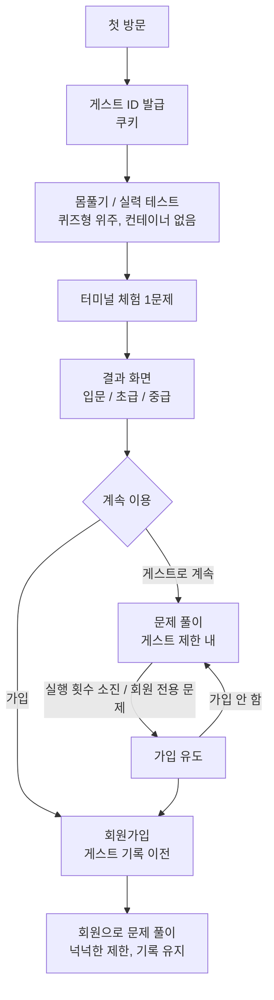

# 기획서

| 항목 | 내용 |
|---|---|
| 프로젝트명 | (가칭) IT 학습 플랫폼 — 이름 미정 |
| 상태 | 초안 |
| 성격 | 개인 프로젝트 (학습 + 포트폴리오 + 지속 운영) |
| 수익화 | 계획 없음 |

## 1. 배경과 목적

- IT 인프라·보안 지식은 **직접 명령어를 쳐 봐야** 익숙해지지만, 학습자가 실습 환경을 직접 준비하기는 번거롭다.
- 브라우저만 있으면 바로 리눅스 환경에 들어가 문제를 풀 수 있는 학습 사이트를 만든다.
- 개발자 본인에게는 다음을 학습하는 목적이 있다.
  - 컨테이너 격리, 자원 제한, 사용자 코드 실행의 보안
  - 큐와 동시성 제어
  - 일본 SI 방식 문서(要件定義書・基本設計書・詳細設計書)와 모던 문서(Markdown, ADR) 양쪽 작성 경험

## 2. 대상 사용자

| 사용자 | 설명 |
|---|---|
| 입문 학습자 | 리눅스 명령어를 배우기 시작한 사람. 몸풀기 테스트와 입문 문제 위주 |
| 실무 준비자 | 인프라·보안 지식을 실습으로 다지고 싶은 사람 |
| 포트폴리오 열람자 | 채용 담당자, 면접관. **가입 없이** 핵심 기능을 체험할 수 있어야 함 |

## 3. 핵심 가치

1. **들어오자마자 해볼 수 있다**: 회원가입 없이 몸풀기 테스트와 실습 시작
2. **진짜 리눅스에서 푼다**: 흉내 낸 터미널이 아니라 실제 컨테이너
3. **내 수준과 성장이 보인다**: 실력 테스트 결과와 레벨

## 4. 기능 범위

### MVP (Phase 0 ~ 3.5)

- 몸풀기 / 실력 테스트 (고정 세트, 퀴즈형 위주 + 터미널 1문제)
- 퀴즈형 문제 (객관식, 단답형)
- 터미널형 문제 (웹 터미널, 정답 판정)
- 게스트 식별 및 진행 기록 (이 브라우저에 한정)
- 동시 실행 제한과 대기열

### 이후 단계

- 회원가입 / 로그인, 게스트 기록 이전
- 레벨과 공개 기록 (랭킹 등)
- 게시판 (비회원 작성 가능)
- IT 뉴스 수집
- 코딩테스트 (실습 엔진 재사용)
- 난이도별 점수, 적응형 테스트, 게이미피케이션 (스트릭 등)

## 5. 사용자 여정 (첫 방문)

**원칙: 가입은 강제하지 않는다.** 가입 없이도 충분히 쓸 수 있고, 가입하면 "더 많이, 더 오래, 기록이 남게" 된다.

## 6. 게스트 / 회원 정책

가입 유도는 마케팅보다 **자원 보호 수단**으로 본다. 컨테이너는 가장 비싼 자원이므로 익명 사용자에게는 조금만 연다.

| 구분 | 게스트 | 회원 |
|---|---|---|
| 몸풀기 / 실력 테스트 | O | O |
| 퀴즈형 문제 | O (전부) | O (전부) |
| 터미널 실습 (입문~초급) | O (일일 횟수·시간 제한) | O (더 넉넉하게) |
| 무거운 문제 (해킹, 다중 컨테이너) | X 또는 맛보기 1개 | O |
| 진행 기록 / 레벨 | 이 브라우저에만 저장 | 계정에 저장, 기기 간 유지 |
| 랭킹 등 공개 기록 | X | O |
| 게시판 | O (닉네임 + 비밀번호) | O |

- 제한 수치(일일 횟수, 시간 등)는 **설정값**으로 두고, PoC에서 측정한 자원 사용량을 보고 정한다.
- 게스트 제한은 쿠키만으로는 쉽게 우회되므로 **게스트 ID와 IP를 함께** 기준으로 삼는다.
- 회원 혜택을 노린 일회용 계정을 막기 위해 가입 시 **이메일 인증**을 넣는다 (회원 기능 단계).

## 7. 제약과 전제

- **저사양 서버 전제**: 동시 실행 수 제한과 대기열로 운영한다.
- **로컬 개발 우선**: 배포 방식과 업체는 보류 ([ADR-0007](../02-architecture/adr/ADR-0007-deployment-strategy-deferred.md)).
- 배포 시점에 어떤 서버로든 옮길 수 있도록 docker-compose와 환경변수 기반으로 구성한다.

## 8. 결정 보류 사항

| 항목 | 보류 이유 | 결정 시점 |
|---|---|---|
| 인증 방식 (세션 / JWT) | 회원 기능 전에는 영향이 작음 | 회원 기능 착수 전 |
| 배포 환경 / 업체 | 로컬에서 자원 사용량을 측정한 뒤 판단 | 배포 검토 시 |
| 서비스 이름 | — | 미정 |
