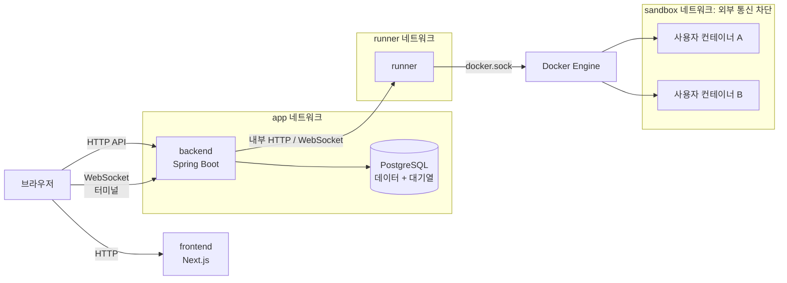
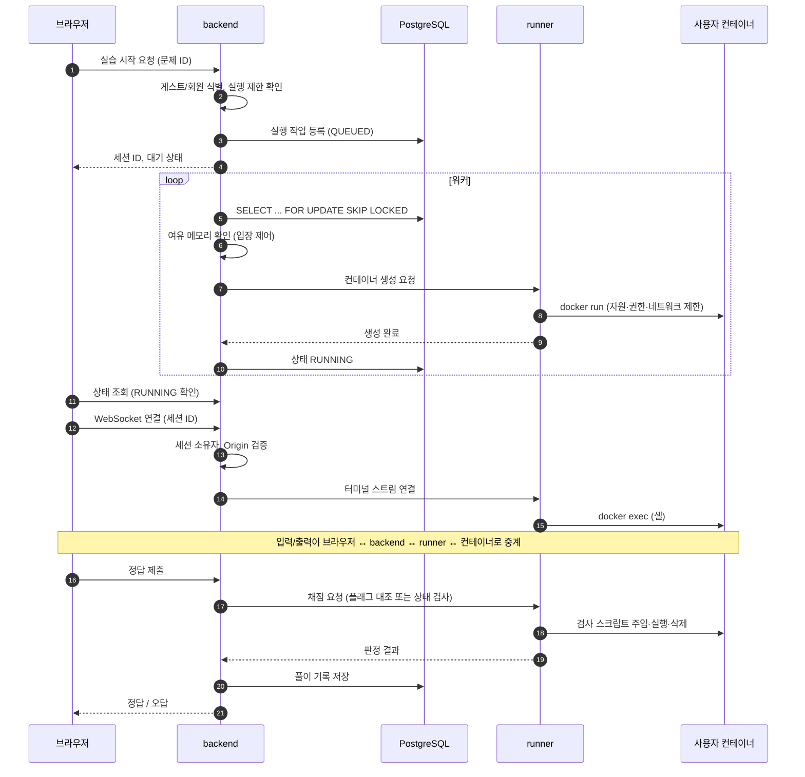

# 시스템 구성

- 상태: 초안
- 범위: **로컬 개발 환경** 기준. 배포 구성은 보류 ([ADR-0007](adr/ADR-0007-deployment-strategy-deferred.md))

## 1. 구성 요소

| 구성 요소 | 기술 | 역할 | Docker 제어 권한 | DB 접근 |
|---|---|---|---|---|
| frontend | Next.js | 화면, 터미널 UI(xterm.js) | X | X |
| backend (API) | Spring Boot | 문제·채점 요청·진행 기록, 게스트 식별, 대기열 등록, 터미널 WebSocket 중계 | **X** | O |
| runner | Spring Boot (또는 경량 Java 앱) | 컨테이너 생성·삭제, `docker exec` 연결, 상태 검사 실행 | **O (유일)** | **X** |
| PostgreSQL | PostgreSQL | 데이터 저장, 대기열 테이블 | — | — |
| 사용자 컨테이너 | Docker | 문제별 실습 환경 | — | X |

> backend와 runner를 처음부터 다른 프로세스로 나누는 이유는 [ADR-0004](adr/ADR-0004-separate-runner.md) 참고.

## 2. 구성도

- **runner는 DB 네트워크에 붙지 않는다.** 대기열에서 작업을 꺼내는 것은 backend가 하고, runner에는 "이 컨테이너를 만들어라" 같은 명령만 전달한다.
- 사용자 컨테이너는 외부 통신이 막힌 네트워크에 둔다. 네트워크가 필요한 문제는 문제 전용 내부 네트워크를 따로 만든다.
- 로컬 docker-compose에서도 이 네트워크 분리를 그대로 재현한다. 운영에서 서버를 나눴을 때와 같은 보안 경계를 로컬에서부터 검증하기 위함이다.

## 3. 터미널 실습 흐름 (MVP)

## 4. 로컬 개발 환경 (예정)

`infra/docker-compose.yml`로 다음을 띄운다.

| 서비스 | 비고 |
|---|---|
| postgres | 로컬 데이터 볼륨 |
| backend | 개발 중에는 IDE에서 직접 실행해도 됨 |
| runner | Docker 소켓 마운트는 이 서비스에만 |
| frontend | 개발 중에는 `npm run dev`로 직접 실행해도 됨 |
| (Later) mailpit | 회원가입 이메일 인증 테스트용 로컬 메일 서버 |

## 5. 열린 질문

- runner ↔ backend 간 통신 방식: HTTP + WebSocket으로 갈지, gRPC로 갈지 (Spike에서 결정)
- runner를 Spring Boot로 할지 더 가벼운 구성으로 할지 (메모리 측정 후 결정)
- Docker 제어 라이브러리: docker-java 사용 예정, Spike에서 검증
