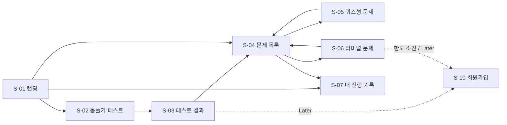
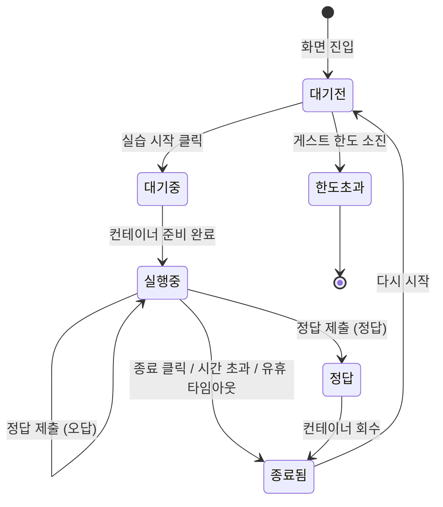

# 화면 목록

- 상태: 초안
- 대상: **G** = 게스트, **M** = 회원

## 화면 목록 (画面一覧)

| ID | 화면명 | 경로 (예정) | 대상 | 우선순위 | 관련 요구사항 |
|---|---|---|---|---|---|
| S-01 | 랜딩 | `/` | G, M | MVP | — |
| S-02 | 몸풀기 / 실력 테스트 | `/placement` | G, M | MVP | FR-TST-001~003 |
| S-03 | 테스트 결과 | `/placement/result` | G, M | MVP | FR-TST-003, 004 |
| S-04 | 문제 목록 | `/problems` | G, M | MVP | FR-PRB-001 |
| S-05 | 문제 상세 (퀴즈형) | `/problems/{slug}` | G, M | MVP | FR-PRB-003, FR-JDG-001 |
| S-06 | 문제 상세 + 터미널 | `/problems/{slug}` | G, M | MVP | FR-TRM-001~006, FR-JDG-001~002 |
| S-07 | 내 진행 기록 | `/me` | G, M | MVP | FR-PRG-001, FR-GST-003 |
| S-10 | 회원가입 | `/signup` | G | Later | FR-MBR-001, FR-GST-004 |
| S-11 | 로그인 | `/login` | G | Later | FR-MBR-002 |
| S-12 | 이메일 인증 완료 | `/verify-email` | G | Later | FR-MBR-001 |
| S-20 | 게시판 목록 / 상세 / 작성 | `/board/...` | G, M | Later | FR-BRD-001~002 |
| S-30 | IT 뉴스 | `/news` | G, M | Later | FR-NWS-001 |
| S-40 | 코딩테스트 | `/coding/...` | G, M | Later | FR-CDT-001 |

> S-05와 S-06은 같은 경로에서 문제 유형(QUIZ / TERMINAL)에 따라 다른 레이아웃을 보여준다.

## 화면 전환도 (画面遷移図) — MVP

## S-06 화면 상태 (터미널 문제)

터미널 문제 화면은 실습 세션 상태에 따라 표시가 바뀐다.

| 상태 | 화면 표시 |
|---|---|
| 대기전 | 문제 설명, "실습 시작" 버튼 |
| 대기중 | 대기 순번 표시 |
| 실행중 | 터미널, 남은 시간, 정답 제출 영역, 종료 버튼 |
| 정답 | 정답 표시, 다음 문제 이동 |
| 종료됨 | 종료 사유 표시 (사용자 종료 / 시간 초과 / 유휴) |
| 한도초과 | 남은 횟수 안내, 가입 유도 (Later) |
