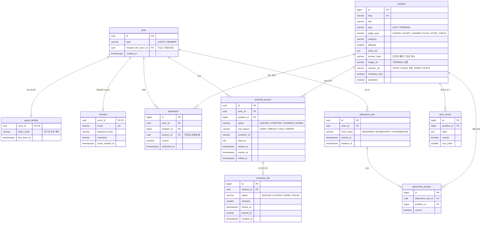

# ERD / 테이블 개요

- 상태: 초안 (MVP 범위)
- 실제 정의는 Flyway 마이그레이션 SQL이 원본이다. 이 문서는 구조와 설계 의도를 설명한다.

## 1. ERD

## 2. 설계 의도

### actor 테이블을 따로 두는 이유
게스트와 회원의 기록을 같은 방식으로 저장하기 위함이다 ([ADR-0006](../02-architecture/adr/ADR-0006-guest-first-actor-model.md)). `submission` 등은 항상 `actor_id`를 참조하므로, 게스트 기능을 나중에 붙이거나 떼도 기록 테이블 구조는 바뀌지 않는다.

**가입 시 병합 방식 (Later에서 확정)**
- 후보 1: 게스트 actor를 회원 actor로 **승격** (type만 MEMBER로 바꾸고 member 행 추가). 기록 이동이 필요 없어 가장 단순
- 후보 2: 이미 회원인 사람이 다른 브라우저의 게스트 기록을 가져오는 경우, 기록의 `actor_id`를 회원 actor로 옮기고 게스트 actor에 `merged_into_actor_id`를 남김
- 같은 문제를 양쪽에서 푼 경우 등 중복 처리 규칙이 필요하다

### 정답을 해시로 저장하는 이유
`answer_hash`에 단답형 정답과 플래그를 해시로 저장한다 ([NFR-SEC-022](../01-requirements/non-functional-requirements.md)). DB가 유출돼도 정답 목록이 그대로 드러나지 않게 하기 위함이다. 객관식 보기의 `correct`는 문제 특성상 평문으로 둔다.

> 나중에 "사용자마다 다른 플래그"(동적 플래그)를 도입하면 공유된 정답을 그대로 베끼는 것도 막을 수 있다. MVP 범위 밖.

### `checker_ref`를 컨테이너 밖에 두는 이유
상태 검사 스크립트는 문제 이미지 안에 넣지 않고 runner 쪽에 보관하며, 제출 시점에만 주입·실행한다 ([NFR-SEC-020](../01-requirements/non-functional-requirements.md)). 이 컬럼은 runner가 찾을 스크립트의 식별자만 가진다.

### `terminal_session.client_ip`를 저장하는 이유
게스트 실행 제한을 게스트 ID와 IP 양쪽으로 걸기 위함이다 ([NFR-SEC-032](../01-requirements/non-functional-requirements.md)). 개인정보이므로 배포 시 보관 기간을 정해야 한다.

### `execution_job`을 `terminal_session`과 분리한 이유
세션은 "사용자 입장에서의 실습 한 번"이고, job은 "워커가 처리할 작업"이다. 재시도, 워커 장애 시 회수(`locked_at` 타임아웃) 같은 큐 전용 상태를 세션 테이블에 섞지 않기 위함이다 ([ADR-0005](../02-architecture/adr/ADR-0005-db-backed-queue.md)). 나중에 코딩테스트 채점 작업도 같은 job 테이블을 공유할 수 있다.

## 3. 열린 질문

- 레벨/경험치 테이블 (`actor_progress`)은 레벨 규칙이 정해지면 추가 (FR-PRG-002, Later)
- 몸풀기 테스트 문제 세트를 테이블로 관리할지 설정 파일로 둘지
- 게시판·뉴스 테이블은 해당 Phase에서 설계
